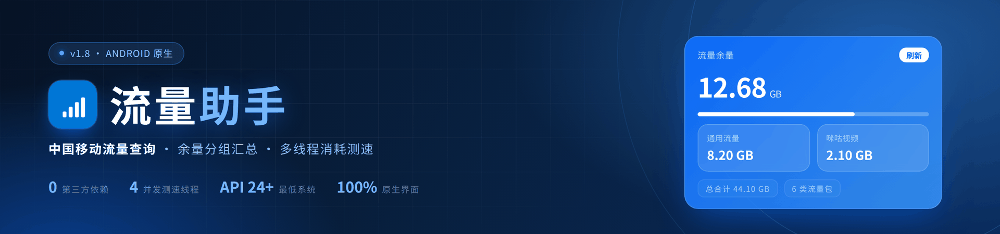
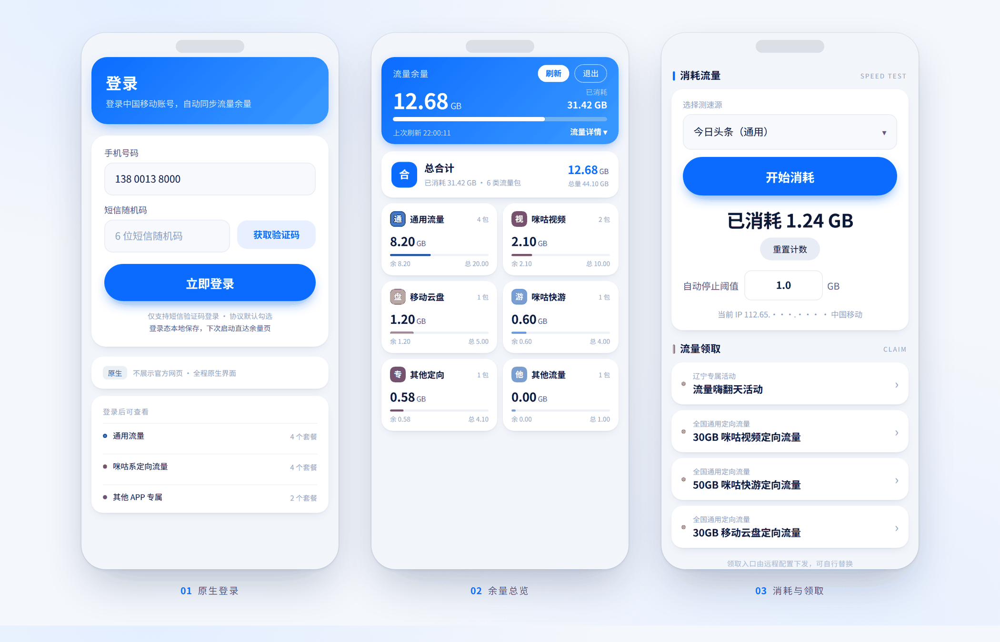
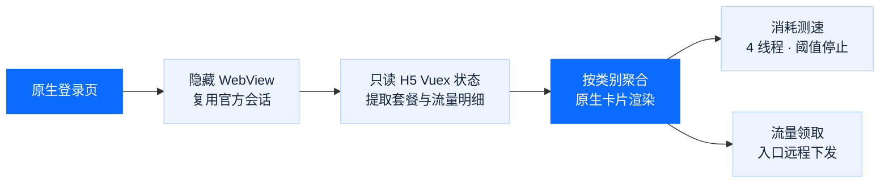

<div align="center">
  
  <br><br>
  <a href="https://github.com/fuoins/flow-assistant/releases/latest"></a>
  <a href="#快速开始"></a>
  <a href="#工作原理"></a>
  <a href="https://github.com/fuoins/flow-assistant/releases"></a>
  <a href="#工作原理"></a>
  <a href="#声明"></a>
  <br><br>
  <b>官方登录态直接查余量 · 按套餐类别分组汇总 · 4 线程消耗测速 · 领取入口远程可配</b>
  <br><br>
  <a href="#功能特性">功能特性</a> ·
  <a href="#界面预览">界面预览</a> ·
  <a href="#工作原理">工作原理</a> ·
  <a href="#快速开始">快速开始</a> ·
  <a href="#配置说明">配置说明</a> ·
  <a href="#常见问题">常见问题</a> ·
  <a href="#版本记录">版本记录</a>
</div>

<br>

> 中国移动的流量余量从来不在一张表里：通用流量、咪咕系定向流量、云盘/快游专属包各自独立计费，官方页面只按套餐逐条罗列，看不出「我到底还剩多少、哪一类快用完了」。
>
> 流量助手把这些条目抓下来，按类别合并成几张卡片，一屏看清；顺手把「怎么把定向流量用掉」和「哪里还能领流量」放进同一个页面。

## 功能特性

| 模块 | 做什么 | 实现要点 |
| :--- | :--- | :--- |
| **余量** | 登录后自动拉取套餐、共享及境外流量，按类别汇总剩余 / 总量 / 已用 | 隐藏 WebView 复用官方会话，只读官方 H5 的 Vuex 页面状态 |
| **登录** | 手机号 + 短信验证码，拼图验证在官方登录页完成 | 使用官方 WebView 流程，不复制验证码接口或模拟校验请求 |
| **测速** | 4 线程并发下载，实时统计已用流量，达阈值自动停止 | `HttpURLConnection` + 64 KB 缓冲，禁用缓存、随机参数防命中 |
| **领取** | 内置辽宁活动与全国定向流量入口，配置可远程整体替换 | 外部 `flow.json` 下发 `claim_groups` |

### 余量查询与分组

从中国移动“余量查询”H5 页面只读套餐数据（名称、类别、已用、剩余、总量），统一换算成 GB 后按规则归并；主套餐、共享、国际漫游及日流量记录分开展示：

| 分组 | 归类规则 | 卡片标识 |
| :--- | :--- | :--- |
| 通用流量 | 套餐类别包含「通用」 | 绿 · 通 |
| 咪咕视频 | APP 专属，且名称含「咪咕视频」 | 红 · 视 |
| 移动云盘 | APP 专属，且名称含「云盘」 | 橙 · 盘 |
| 咪咕快游 | APP 专属，且名称含「咪咕快游」 | 紫 · 游 |
| 其他 APP 专属 | 其余的 APP 专属套餐 | 灰 · 专 |
| 国内其他 / WLAN | 官方 H5 单独返回的其他国内和 WLAN 流量 | 灰 / 蓝 |
| 共享 / 国际 / 日用 | 读取共享流量、境外流量包与日用明细状态 | 蓝 / 紫 / 绿 |
| 套餐外 | 官方 H5 返回的套餐外使用条目 | 红 · 外 |

展示顺序为「基础套餐合计 → 通用流量 → APP 专属合计 → 其他流量类别」，点击小卡可展开套餐明细。单位自动在 KB / MB / GB / TB 之间切换；数据模块异步加载时会重试，未将共享、国际、日用和套餐外用量重复算入基础套餐合计。

### 登录与会话

- **仅短信验证码登录**，服务协议默认勾选，手机号可记住并在下次启动时回填。
- **官方滑块验证**：获取短信验证码时显示中国移动官方登录页，由用户在该页面完成拼图；若页面改版导致自动触发失败，可直接点击页面上的“获取短信随机码”。
- **登录态本地保存**：Cookie 备份到 `SharedPreferences("flow_cookies")`，启动时回填到 `touch / wx / login / wap / app / shop` 等官方域名，有效则直接进入余量页。
- **跳转看门狗**：提交登录后约 7.2 秒仍未落到目标页，直接跳转流量页，避免卡在官方跳转链。

### 消耗测速

- 测速源带类型标签（通用 / 定向），卡片式选择器弹窗单选。
- 4 个线程各自循环下载，实时累计接收字节，每秒刷新一次读数。
- 可填写「自动停止阈值」（GB），达到后自动停止并断开全部活动连接。
- 支持一键重置计数，开始消耗时显示当前出口 IP 与归属地，便于确认走的是蜂窝网络。

### 流量领取

默认内置 1 个辽宁专属活动与 6 个全国通用定向流量入口（咪咕视频、咪咕快游、咪咕阅读、咪咕音乐、移动云盘、咪咕悦看），点击用系统浏览器打开官方活动页；整套入口也可由远程配置替换成你所在省份的活动。

## 界面预览

<p align="center">
  
</p>

<p align="center"><sub>界面示意：按当前源码的布局、配色与文案绘制</sub></p>

- **头部即结论**：剩余量、已消耗、使用进度与上次刷新时间都在第一张卡里，不用滚动。
- **两列小卡**：每类流量一张卡，剩余 / 总量 / 进度一目了然，点击展开套餐明细。
- **同页完成**：往下就是消耗测速与流量领取，不跳转、不打开官方网页。

## 工作原理



### 三个取舍

- **登录验证跟随官方 WebView**：不复刻验证码、业务 API 或请求签名；余量查询通过隐藏 WebView 复用官方会话，只读已加载页面中的套餐状态。
- **纯原生、零依赖**：单文件 `Activity` 手写布局，不引第三方 UI / 网络 / 图片库，APK 体积与启动开销都可控。
- **没有后端**：手机号、Cookie、配置全部留在本机，测速源与领取入口通过一份公开 JSON 下发。

## 快速开始

### 直接安装

已发布版本可前往 [Releases](https://github.com/fuoins/flow-assistant/releases/latest) 下载 `flow-assistant.apk`。最新源码修复版的 APK 可在仓库 Actions 中最近一次成功的 **Build & Release APK** 工作流下载构建产物；安装前请允许「安装未知来源应用」。首次启动需要登录中国移动账号（短信验证码）。

### 环境要求

| 依赖 | 版本 | 用途 |
| :--- | :--- | :--- |
| JDK | 17 | 编译源码，`build.sh` 通过 `JAVA_HOME` 指定 |
| Android SDK Platform | 34 | 提供编译期 `android.jar` |
| Android Build Tools | 34.0.0 | `aapt2` / `d8` / `zipalign` / `apksigner` |
| 最低运行系统 | Android 7.0（API 24） | 对应 `minSdkVersion 24` |

> 运行前提：一张可接收短信的中国移动手机号，以及 Android 7.0 及以上的设备。

### 从源码构建

仓库里的 `build.sh` 是作者本机的一键脚本，顶部 `WS` 写死了工作区路径，直接运行前需要改成你自己的目录。也可以直接在仓库根目录执行下面这组命令：

<details>
<summary>展开完整构建命令</summary>

```bash
export JAVA_HOME=/path/to/jdk17
export ANDROID_HOME=/path/to/android-sdk
BT="$ANDROID_HOME/build-tools/34.0.0"
JAR="$ANDROID_HOME/platforms/android-34/android.jar"

rm -rf obj dex build && mkdir -p obj dex build
javac -cp "$JAR" -d obj src/com/cmcc/flowapp/*.java
"$BT/d8" --release --lib "$JAR" --output dex $(find obj -name '*.class')
"$BT/aapt2" compile --dir res -o build/res.zip
"$BT/aapt2" link -o build/base.apk -I "$JAR" \
  --manifest AndroidManifest.xml build/res.zip --auto-add-overlay
(cd dex && zip -q ../build/base.apk classes.dex)
"$BT/zipalign" -f 4 build/base.apk build/aligned.apk

# 首次构建会自动生成 debug.keystore
keytool -genkeypair -v -keystore debug.keystore -alias debug \
  -keyalg RSA -keysize 2048 -validity 10000 \
  -storepass android -keypass android -dname "CN=Android Debug,O=Android,C=US"
"$BT/apksigner" sign --ks debug.keystore --ks-key-alias debug \
  --ks-pass pass:android --key-pass pass:android \
  --out "build/流量助手.apk" build/aligned.apk
```

</details>

产物为 `build/流量助手.apk`，使用 debug 签名，仅供自用安装；如需上架或长期分发，请换成自己的正式签名。

## 配置说明

应用启动时会拉取 `MainActivity.CONFIG_URL` 指向的 JSON（默认 `https://zy520.de5.net/flow.json`，超时 10 秒，HTTPS 失败自动回退 HTTP）。拉取失败或字段为空时，继续使用代码内置的默认测速源与领取入口。

```json
{
  "speed_sources": [
    { "name": "今日头条", "url": "https://example.com/video.mp4", "type": "通用" },
    { "name": "移动云盘", "url": "https://example.com/big.zip", "type": "定向" }
  ],
  "claim_groups": [
    {
      "title": "全国通用定向流量",
      "links": [
        { "name": "30GB 咪咕视频定向流量", "url": "https://example.com/claim" }
      ]
    }
  ]
}
```

| 字段 | 类型 | 说明 |
| :--- | :--- | :--- |
| `speed_sources[].name` | string | 测速源显示名称 |
| `speed_sources[].url` | string | 直链下载地址，建议大文件或长视频流 |
| `speed_sources[].type` | string | `通用` / `定向`，仅拼在名称后作提示 |
| `claim_groups[].title` | string | 领取入口的分组标题 |
| `claim_groups[].links[].name` | string | 入口名称，如「30GB 咪咕音乐定向流量」 |
| `claim_groups[].links[].url` | string | 活动页地址，点击后用系统浏览器打开 |

> 测速源会以 4 线程反复下载，请使用自己有权访问、且允许这样访问的资源；体积太小的文件很快就能下完，很难持续产生流量。

## 项目结构

```
flow-assistant/
├── AndroidManifest.xml    # 单 Activity · minSdk 24 / target 34
├── build.sh               # javac → d8 → aapt2 → zipalign → apksigner
├── res/
│   └── drawable/icon.png  # 应用图标
├── src/com/cmcc/flowapp/
│   └── MainActivity.java  # 全部界面与逻辑（约 2.4k 行）
├── assets/                # README 配图
└── README.md
```

## 常见问题

| 现象 | 可能原因 | 处理 |
| :--- | :--- | :--- |
| 一直停在登录页 / 转圈 | Cookie 过期，或官方跳转链变化 | 点「刷新」重试；仍不行则「退出」后重新登录 |
| 余量显示 `--`、提示未获取到数据 | 官方页面或数据状态改版、网络异常 | 先刷新；持续出现时需检查 H5 的状态字段与登录态 |
| 滑块验证反复失败 | 触发官方风控 | 换网络环境、隔几分钟再试；验证码本身有失败重试次数 |
| 测速统计与运营商计费不一致 | 统计口径不同 | 客户端只统计接收字节，计费还包含协议开销与计费周期差异，以运营商为准 |
| 不在辽宁，能用吗 | 领取入口有地域性 | 查询走全国统一入口，通常不受省份限制；领取入口可用远程配置替换成本省活动 |
| 会不会上传我的数据 | — | 没有后端，手机号与 Cookie 只写在本机 `SharedPreferences` |

## 版本记录

- **v1.9.4**（Actions 构建）— 将余量查询切换到新的中国移动官方 H5 页面，读取套餐、共享、国际及日流量状态，扩展登录 Cookie 保存域名
- **v1.9.3**（Actions 构建）— 短信验证码改用官方可见登录页完成拼图，移除对官网内部滑块接口的运行时依赖
- **v1.9.2** — 未登录直接进登录页不绕流量页；加载超时回登录页；登录流程加超时兜底并优化跳转链
- **v1.9.1** — 修复登录后误报「网络加载失败」；流量页加载失败自动重试 2 次，错误提示带错误码
- **v1.9** — 新增启动/刷新加载超时与错误兜底，修复一直卡在「正在加载」及文字截断问题；接入 GitHub Actions 自动打包发布
- **v1.8** — 测速源选择器改为卡片式弹窗单选；应用更名「流量助手」
- **v1.7** — 原生滑块验证；全新会话防风控；登录与启动取数的进度反馈

## 声明

> 本项目仅供学习与技术交流，请勿用于商业用途。流量数据来源于中国移动官方页面，消耗测速请合理使用，定向流量的识别与计费以运营商为准。因使用本工具产生的任何后果由使用者自行承担。

<div align="center">
  <sub>如果这个项目对你有帮助，欢迎点一个 Star</sub>
</div>
